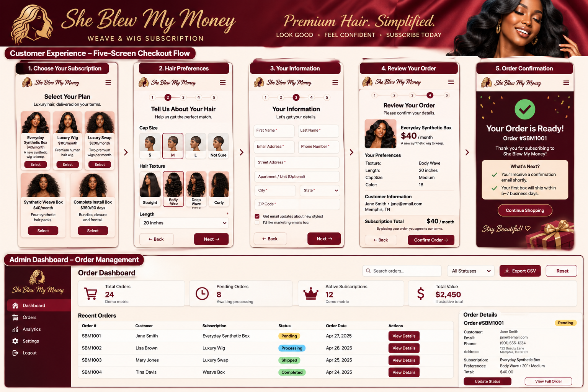

We can now establish the visual standards that will guide implementation.
1. Approved brand identity

Brand color palette

Burgundy#650D20

Champagne#D8B56D

Warm cream#FFF4E9

Charcoal#292020

Design characteristics
- Elegant, feminine luxury aesthetic.
- Premium hair-product photography.
- Gold accents for branding and highlights.
- Cream backgrounds for readability.
- Burgundy buttons and navigation.
- Rounded cards and subtle shadows.

2. Approved customer experience
The five-screen checkout is now the standard:
1. Choose your subscription.
2. Hair preferences.
3. Customer information.
4. Review your order.
5. Order confirmation.
The interface must remain simple enough for someone unfamiliar with online shopping.
3. Approved admin experience
The dashboard will use the same brand identity but with a more functional business-software layout.
- Burgundy sidebar.
- Cream and white workspace.
- Order statistics.
- Searchable order table.
- Status indicators.
- Individual order details.
- CSV export.
The customer experience and admin dashboard should feel like two parts of the same business.
4. Visual implementation rules
Before coding, these standards are locked:
- Mobile-first responsive design.
- Consistent navigation and branding across all pages.
- Large, accessible buttons and form controls.
- Product photography with consistent image proportions.
- Clear checkout progress indicators.
- Consistent spacing, typography, and card styles.
- No real payment fields or payment integrations.
- Clear demo labels wherever simulated transactions appear.